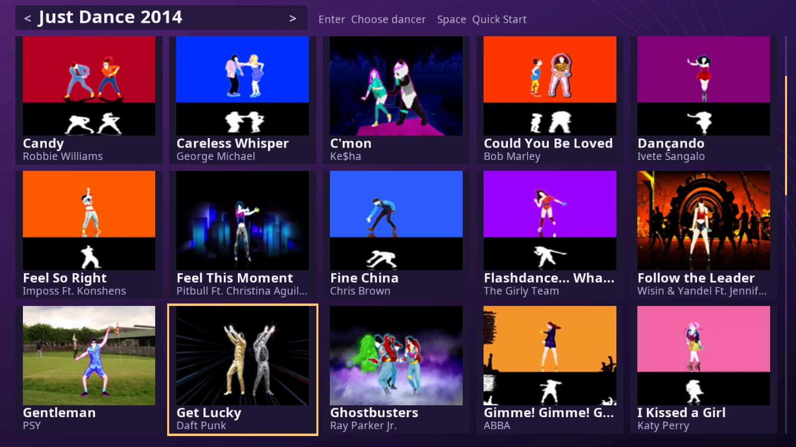
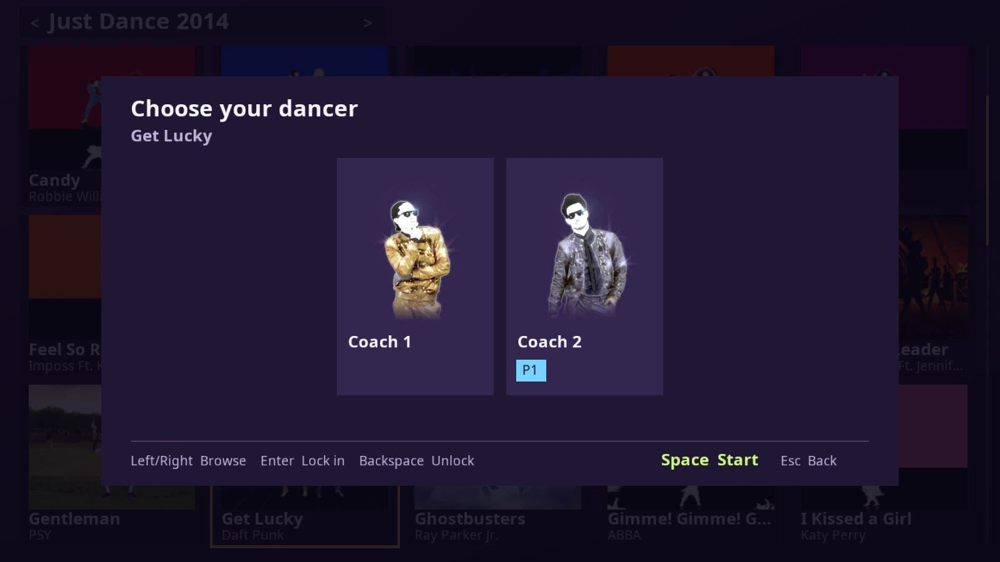
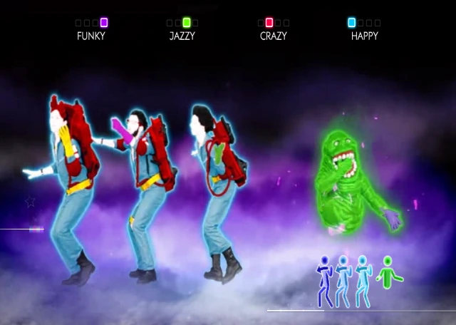

# Just Dance Couch

**[Visit the Just Dance Couch website](https://filip722.github.io/Just-Dance-Couch/)**

Play your Just Dance Wii collection on Linux from a single fullscreen song picker. Just Dance Couch recompiles your own Wii disc backups with Wii Recomp and launches each song with its original choreography and motion scoring.

[Quick start](#quick-start) · [Disc images and hashes](docs/disc-images.md) · [Wii Remotes](#wii-remotes) · [Configuration](#configuration) · [License](#license-and-credits)



## Features

- **One song library.** Browse an alphabetical, five-column grid with music and lossless coach video previews where available. Editions appear in Wii release order.
- **Straight to the dance.** The launcher warms the current edition while you browse, skips the intro and game menus, and brings you back to the grid on HOME.
- **Up to four Wii Remotes.** Players get numbered slots as they connect and can pick their own dancer on supported multi-coach routines.
- **18 supported Wii editions.** Browse Classic routines through Just Dance 2020, including Summer Party and Greatest Hits. Kids and Disney Party use their on-disc song lists. Supported add-ons share a DLC page.
- **Consistent volume.** Preview and gameplay levels use Just Dance 4 as their reference, with peak protection in gameplay.

## Quick start

### 1. Install the build dependencies

Use a Linux desktop on an x86-64-v3 CPU (AVX2 and FMA) with a working Vulkan driver, Python 3.12 or newer, and several gigabytes of temporary build space. Install Clang, Rust 1.85 or newer with Cargo, CMake, Ninja, pkg-config, FFmpeg, GNU binutils, patch, the LZO2 runtime, and the development libraries below.

On Debian 13, install the packages with apt.

```bash
sudo apt install git ca-certificates build-essential python3 clang rustc cargo cmake ninja-build \
  pkg-config ffmpeg binutils patch liblzo2-2 libsdl3-dev libglfw3-dev libvulkan-dev \
  libshaderc-dev libasound2-dev libfontconfig-dev libfreetype-dev libusb-1.0-0-dev
```

### 2. Build one game

Clone the repository and point the builder at an ISO, RVZ, or WBFS backup of a disc you own. This example uses **Just Dance 2014 (USA, revision 0)**. Set `image` to your backup's path. The [disc list](docs/disc-images.md) has the ID, region, revision, and SHA-256 for each edition.

```bash
git clone https://github.com/Filip722/Just-Dance-Couch.git
cd Just-Dance-Couch
image="$HOME/Wii/Just Dance/Just Dance 2014.rvz"
python3 -B pilot.py build --disc SJOE41 --image "$image"
python3 -B pilot.py couch
```

The first build downloads pinned tools and runtime sources, verifies the disc, and compiles its Wii code for your PC. The `couch` command builds the picker with all the supported editions you have compiled in that cache. Build commands extract a disc temporarily when they need its files. The launcher then reads directly from your original ISO, RVZ, or WBFS during play. Keep the images accessible, including any network share they live on.

### 3. Open the picker

```bash
couch="${XDG_CACHE_HOME:-$HOME/.cache}/just-dance-couch/bin/just-dance-couch"
"$couch" --loopback
```

Use the arrow keys and Enter to try the picker and launch a song. Keep FFmpeg on your `PATH` for coach video previews. For motion scoring, use a Wii Remote. See [Wii Remotes](#wii-remotes).

To add another edition, run `pilot.py build` with its disc ID and image path, then rerun `pilot.py couch`.

## Screenshots

| Choose your dancer | Four-player gameplay |
| --- | --- |
|  |  |

## Wii Remotes

Connect a Nintendo Wii Bluetooth module (`057e:0305`) over USB. Close Dolphin if it is using the module. Your desktop user needs read and write access to the device.

On Linux desktops with systemd, this udev rule grants access to the active local user. Reconnect the module after reloading the rules.

```bash
sudo tee /etc/udev/rules.d/70-just-dance-couch.rules >/dev/null <<'RULE'
SUBSYSTEM=="usb", ENV{DEVTYPE}=="usb_device", ATTR{idVendor}=="057e", ATTR{idProduct}=="0305", TAG+="uaccess"
RULE
sudo udevadm control --reload-rules
```

```bash
couch="${XDG_CACHE_HOME:-$HOME/.cache}/just-dance-couch/bin/just-dance-couch"
"$couch" --usb-wii
```

On first pairing, press the red **SYNC** button inside the battery compartment. Wait for the numbered light to go solid before pairing the next remote. On later launches, press a button to wake each paired remote. New connections fill the lowest free slot. Player 1 starts songs and can exit the launcher by pressing **−** twice quickly in the grid or coach picker.

To use a BlueZ-paired remote, run `"$couch"` without flags. This mode needs a readable and writable `hidraw` device with HID reporting available to userspace.

## Controls

| Action | Wii Remote | Keyboard with `--loopback` |
| --- | --- | --- |
| Browse songs | D-pad | Arrow keys |
| Select a song or dismiss results | A | Enter |
| Skip coach selection on a multi-coach song | + | Space |
| Return from a dance | HOME | Escape |
| Exit from the song grid | − twice on Player 1 | Escape |

Hold a direction to keep moving. From the top row, press **Up** to focus the edition name, **Left** or **Right** to switch editions, then **Down** to return to the songs.

On multi-coach songs that support the picker, each player chooses with **Left** or **Right**, locks in with **A** (Enter), and unlocks with **B** (Backspace). Player 1 starts with **+** (Space). The game assigns any unlocked players. The coach picker is available in Just Dance 3, Greatest Hits, Just Dance 4, and Just Dance 2014–2020. Just Dance 2 and Summer Party assign duet roles by remote slot. Kids and Disney Party use their own dancer assignments.

## DLC

Build the corresponding USA disc first. Just Dance Couch imports owned Wii add-on WADs for Just Dance 2, 3, 4, 2014, and 2015. Install Python's `cryptography` package (`python3-cryptography` on Debian) and pass the directory that contains the WADs.

```bash
python3 -B pilot.py couch --dlc-dir "$HOME/Wii/Just Dance/DLC"
```

The DLC page appears after the last installed edition. For a song with multiple available DLC copies, the newest edition takes priority. Each disc keeps its own songs.

## Configuration

| Setting | Default and usage |
| --- | --- |
| Disc images | Pass `--image PATH` to `pilot.py build`. Set `JUST_DANCE_BACKUPS` to change the default directory from `~/Wii/Just Dance`. The [disc list](docs/disc-images.md) gives the filenames used without `--image`. |
| Add-on WADs | Set `--dlc-dir PATH` when running `pilot.py couch`. The default is the `DLC` subdirectory of the backup directory. |
| Builds and cached media | `${XDG_CACHE_HOME:-$HOME/.cache}/just-dance-couch/`. This holds the native launcher, image links under `images/`, lossless previews, and extracted DLC. Set `XDG_CACHE_HOME` to an absolute path before building and launching to use a different drive. |
| Saves and Wii Remote pairings | `${XDG_DATA_HOME:-$HOME/.local/share}/just-dance-couch/`. Set `XDG_DATA_HOME` to an absolute path to use a different data directory. |
| Custom SDL3 install | Export `SDL3_PREFIX` with the install prefix before building. |
| Build parallelism | Both `build` and `couch` accept `--jobs N` and default to six jobs. |

### Move disc images

Each title uses the image registered by `pilot.py build --image PATH`. After moving a verified backup, update its link. Replace `SJOE41` with your disc ID.

```bash
cache="${XDG_CACHE_HOME:-$HOME/.cache}/just-dance-couch"
ln -sfn -- "/path/to/drive/Just Dance 2014.rvz" "$cache/images/SJOE41"
```

To upgrade an existing extracted install, register each backup with `pilot.py build --disc ID --image PATH` and rebuild the picker. Once each title plays from its image, its old extracted directory under `discs/` can be removed. The `dlc/` directory stores the extracted WAD content used at runtime.

### Troubleshooting

- **Disc missing or mismatched.** Check whether the image link points to an accessible backup and compare its ID, region, revision, and executable hash with the [disc list](docs/disc-images.md).
- **Adapter unavailable.** Check that your module appears as `057e:0305` in `lsusb`, that your user can access it, and that Dolphin has released it.
- **A song fails to open.** Read `game-<launcher-pid>.log` in the cache directory. Set `JUST_DANCE_GAME_TRACE=1` before launching to send the game trace to the terminal.

## License and credits

The original Just Dance Couch source code and documentation are available under the MIT License. [License](LICENSE)

- Wii Recomp provides the static recompiler and native console runtime. The patches in `patches/` modify Wii Recomp and carry its GPL-3.0-or-later terms. The Git history records the patch dates. [Wii Recomp](https://github.com/Zontex/wii-recomp) · [GPLv3](LICENSES/GPL-3.0.txt)
- Nod reads original disc images. [Nod](https://github.com/encounter/nod) · [MIT license](LICENSES/Nod-MIT.txt)
- BTstack provides direct USB Bluetooth support. The patch in `deps/btstack-usb.patch` modifies the USB transport (copyright © 2014 BlueKitchen GmbH) under BTstack 1.8.3's personal-use and noncommercial terms. [BTstack license](LICENSES/BTstack-1.8.3.txt)

Just Dance Couch is an independent fan project. Just Dance and the game artwork in these screenshots belong to their respective owners. Build locally using your own disc and DLC backups.
